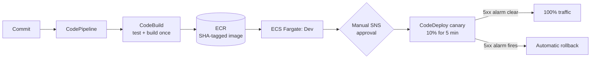
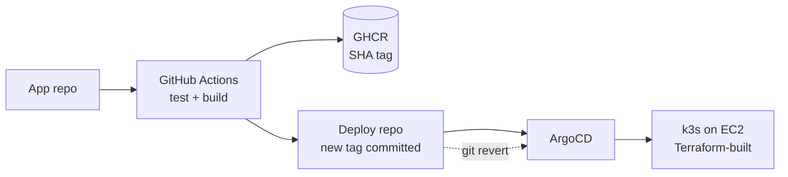
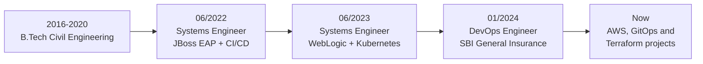

 

 

  

<a href="#-about-me">About</a> &nbsp;·&nbsp;
<a href="#-tech-stack">Stack</a> &nbsp;·&nbsp;
<a href="#-featured-projects">Projects</a> &nbsp;·&nbsp;
<a href="#-experience">Experience</a> &nbsp;·&nbsp;
<a href="#-how-i-work">How I work</a> &nbsp;·&nbsp;
<a href="#-github-stats">Stats</a> &nbsp;·&nbsp;
<a href="#-lets-connect">Contact</a>

## 👋 About Me

I'm a **DevOps Engineer at Tata Consultancy Services (TCS)** with **4+ years** supporting **BFSI insurance** applications: production support, release management, incident management and CI/CD on **JBoss EAP, Oracle WebLogic, Docker, Kubernetes, Linux and Spring Boot**. Outside work, I build complete delivery platforms to deepen my hands-on skills.

<table>
<tr>
<td width="50%" valign="top">

### 🏢 At work
- 🐳 Containerizing **WebLogic** and **Spring Boot** apps for cloud-native modernization
- ☸️ Running workloads on **Kubernetes**: Deployments, Services, Ingress, ConfigMaps, Secrets, Persistent Volumes
- 🔐 **SSL certificates**, self-healing and environment-specific configuration
- 🚀 Releases via **Jenkins, Maven, Git, SonarQube** across UAT, Pre-Prod and Production
- 🔎 **Root cause analysis**, incident management and troubleshooting

</td>
<td width="50%" valign="top">

### 🧪 On my own time
- ☁️ **AWS-native CI/CD** with blue/green canary releases on ECS Fargate
- 🔁 **GitOps** with ArgoCD and a self-written Helm chart
- 🏗️ **Terraform** environments that rebuild from code in about 10 minutes
- 📊 **Observability** with Prometheus and Grafana
- 💸 Teardown and billing-check scripts to keep lab costs near zero

</td>
</tr>
</table>

| 🎓 Education | 📜 Certification | 🗣️ Languages | 📍 Location |
|:---:|:---:|:---:|:---:|
| B.Tech Civil Engineering, RGUKT IIIT Nuzvid | AWS Certified Cloud Practitioner | Telugu · English · Hindi | Hyderabad, India |

---

## 🧰 Tech Stack

**🔄 CI/CD & GitOps** 

**📦 Containers & Orchestration** 

**☁️ Cloud & Infrastructure as Code** 

**🏛️ Middleware & Applications** 

**📈 Monitoring, Scripting & Systems** 

<b>☁️ AWS services I've worked with</b>

 

`EC2` `IAM` `VPC` `S3` `ECS Fargate` `ECR` `ALB` `CloudWatch` `CodePipeline` `CodeBuild` `CodeDeploy` `SNS`

---

## 🚀 Featured Projects

<table>
<tr>
<td width="33%" valign="top">

### ☁️ [AWS CI/CD Platform](https://github.com/immadhav7/aws-cicd-platform)
**Blue/green delivery on ECS Fargate**

Build once, deploy to dev, promote to prod behind an approval gate. Canary release with automatic rollback.

</td>
<td width="33%" valign="top">

### 🔁 [LiveQuiz](https://github.com/immadhav7/livequiz-deploy)
**GitOps delivery platform**

Separate app and deploy repos, ArgoCD with a custom Helm chart, and rollback with `git revert`.

</td>
<td width="33%" valign="top">

### 🚦 [DeployGate](https://github.com/immadhav7/DeployGate)
**CI/CD and Kubernetes pipeline**

Jenkins pipeline to a self-managed k3s cluster, with Prometheus and Grafana monitoring.

</td>
</tr>
</table>

### 🔭 Project architectures

**AWS CI/CD Platform: blue/green with automatic rollback**

**LiveQuiz: GitOps flow**

<b>☁️ AWS CI/CD Platform: details</b>

 

- Each commit is **tested and built once**, tagged with its SHA, deployed to dev, then promoted to prod behind a **manual SNS approval gate**
- **Blue/green canary deploys** with CodeDeploy (10% traffic for 5 minutes) and a CloudWatch 5xx alarm
- Demonstrated **automatic rollback** using a simulated fault that passed health checks but failed real requests
- **Least-privilege IAM** per service and **immutable ECR tags**, so every running version maps to exactly one commit
- Per-environment CloudWatch dashboards plus teardown and billing-check scripts (about $0.15/hr with both environments up)

<b>🔁 LiveQuiz: details</b>

 

- **GitHub Actions** tests the app, pushes a **SHA-tagged image to GHCR**, then commits the new tag to a separate deploy repo
- **ArgoCD + self-written Helm chart**: dev auto-syncs with self-heal; prod changes only via reviewed PR plus manual Sync
- **Terraform** provisions EC2 + k3s (single-IP security group, IMDSv2, encrypted disk); the full environment **rebuilds from code in about 10 minutes**

<b>🚦 DeployGate: details</b>

 

- Multi-stage Docker build producing a minimal **non-root** image
- Declarative **Jenkins pipeline as code**: build, 37 unit tests, SonarCloud analysis, image build/tag on every commit
- Deployed to **k3s on EC2** with Deployments, Services, ConfigMaps, Secrets, PVCs and in-cluster PostgreSQL
- **Prometheus + Grafana** monitoring (7 healthy scrape targets verified via PromQL)
- Diagnosed an I/O bottleneck (84.9% I/O wait) and an undersized EBS volume using `top`, `free` and CloudWatch; provisioning automated with **Ansible**

---

## 💼 Experience

<table>
<tr>
<th>Period</th>
<th>Role</th>
<th>Client</th>
<th>Focus</th>
</tr>
<tr>
<td>01/2024 – Present</td>
<td><b>DevOps Engineer</b> TCS</td>
<td>SBI General Insurance</td>
<td>Kubernetes, containerization, CI/CD, production support</td>
</tr>
<tr>
<td>06/2023 – 12/2023</td>
<td><b>Systems Engineer</b> TCS</td>
<td>Bajaj Allianz General Insurance</td>
<td>WebLogic administration, Spring Boot on Kubernetes</td>
</tr>
<tr>
<td>06/2022 – 05/2023</td>
<td><b>Systems Engineer</b> TCS</td>
<td>Future Generali India Insurance</td>
<td>JBoss EAP 8, Jenkins releases, shell automation</td>
</tr>
</table>

### 🛤️ Career path

---

## 🧭 How I Work

| Principle | What it looks like in my projects |
|---|---|
| 🔁 **Build once, promote everywhere** | One SHA-tagged image moves from dev to prod, so what I tested is what ships |
| ⏪ **Rollback should be boring** | `git revert` in GitOps, automatic canary rollback on AWS |
| 🔒 **Least privilege by default** | Per-service IAM, IMDSv2, single-IP security groups, encrypted disks |
| 🏗️ **Everything as code** | Terraform, Helm and pipelines in Git, with environments rebuilt on demand |
| 💸 **Cost awareness** | Teardown and billing-check scripts keep lab environments near zero |
| 🔎 **Find the root cause** | RCA habits from production support, not just clearing the alert |

---

## 📚 Currently Learning

## 🤝 Open To

> DevOps and Cloud Engineer roles · CI/CD and GitOps work · Cloud infrastructure and IaC · Open source collaboration

---

## 📊 GitHub Stats

---

## ⚡ Fun Facts

- 🏃 I enjoy fitness, road running and travelling
- 🤖 I believe **every repetitive task can (and should) be automated**
- 🎓 I came into DevOps from **Civil Engineering**, where "build it so it doesn't fall over" already applied

---

## 📫 Let's Connect

  

