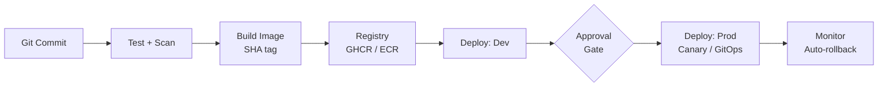

---

## 💫 About Me

DevOps Engineer at **Tata Consultancy Services (TCS)** with **4+ years** of experience in CI/CD automation, release management, cloud infrastructure and production deployments across **BFSI** clients (insurance domain).

- 🏢 Day to day: owning Jenkins pipelines (Git → SonarQube → Maven/Gradle) and releasing across **UAT, Pre-Prod and Production**
- 🛠️ Writing Bash automation that cuts manual deployment effort and keeps releases consistent
- ☁️ Building personal projects on **Kubernetes, Terraform, ArgoCD and AWS-native CI/CD** to take my hands-on skills beyond the day job
- 🎓 B.Tech Civil Engineering (RGUKT IIIT Nuzvid) → self-taught into DevOps

## 🎯 Career Goal

Looking for a **DevOps / Cloud Engineer** role in **product-based companies and remote teams**, working on cloud-native infrastructure, CI/CD automation, GitOps and reliability.

---

## 🧰 Tech Stack

**CI/CD & GitOps**

 

**Cloud & Infrastructure as Code**

**Containers & Orchestration**

**Monitoring & Scripting**

<b>📋 AWS services I've worked with</b>

 

`EC2` `IAM` `VPC` `EBS` `S3` `CloudWatch` `ECR` `EKS` `ECS Fargate` `ALB` `CodePipeline` `CodeBuild` `CodeDeploy` `SNS` `AWS VDI`

---

## 🚀 Featured Projects

### 1️⃣ [DeployGate: End-to-End CI/CD & Kubernetes Deployment Pipeline](https://github.com/immadhav7/DeployGate)

Containerized a Spring Boot + PostgreSQL app and delivered it through a full Jenkins pipeline to a self-managed Kubernetes cluster on AWS.

- Multi-stage Docker build producing a minimal **non-root** image
- Declarative **Jenkins pipeline as code**: build, 37 unit tests, SonarCloud analysis, Docker image build/tag on every commit
- Deployed to **k3s on EC2** with Deployments, Services, ConfigMaps, Secrets, PVCs and in-cluster PostgreSQL
- **Prometheus + Grafana** monitoring (7 healthy scrape targets verified via PromQL)
- Diagnosed two real incidents (swap-driven I/O bottleneck at 84.9% I/O wait, undersized EBS volume) using `top`, `free`, `systemctl` and CloudWatch
- Provisioning automated with **Ansible**; Terraform IaC authored for VPC, EKS and IAM

`GitHub` `Spring Boot` `Docker` `Kubernetes` `Jenkins` `SonarCloud` `Ansible` `Terraform` `Helm` `Prometheus` `Grafana` `AWS`

---

### 2️⃣ [LiveQuiz: GitOps Delivery Platform on AWS](https://github.com/immadhav7/livequiz-deploy)

A GitOps delivery platform for a Spring Boot quiz web app, with app code and deploy config split across repos.

- **GitHub Actions** tests the app, pushes a **SHA-tagged image to GHCR**, then commits the new tag to a separate deploy repo
- **ArgoCD + self-written Helm chart**: dev auto-syncs with self-heal; prod changes only via reviewed PR plus manual Sync; **rollback is a `git revert`**
- **Terraform** provisions EC2 + k3s (single-IP security group, IMDSv2, encrypted disk); the full environment **rebuilds from code in ~10 minutes**

`GitHub Actions` `GHCR` `Docker` `Terraform` `Helm` `ArgoCD` `k3s`

---

### 3️⃣ [AWS CI/CD Platform: Multi-Environment Blue/Green Delivery on ECS Fargate](https://github.com/immadhav7/aws-cicd-platform)

An AWS-native, multi-environment delivery platform built entirely with Terraform.

- Each commit is **tested and built once**, tagged with its SHA, deployed to dev, then promoted to prod behind a **manual SNS approval gate**
- **Blue/green canary deploys** with CodeDeploy (10% traffic for 5 minutes) and a CloudWatch 5xx alarm
- Demonstrated **automatic rollback** using a simulated fault that passed health checks but failed real requests
- **Least-privilege IAM** per service and **immutable ECR tags**, so every running version maps to exactly one commit
- Per-environment CloudWatch dashboards plus teardown and billing-check scripts (~$0.15/hr with both environments up)

`AWS` `Terraform` `ECS Fargate` `CodePipeline` `CodeBuild` `CodeDeploy` `ECR` `ALB` `CloudWatch` `SNS`

---

### 🔄 How my projects deliver code

---

## 💼 Experience

| Period | Role | Client |
|---|---|---|
| 01/2024 – Present | **DevOps Engineer**, TCS | SBI General Insurance (SBIG BFSI Products) |
| 06/2023 – 12/2023 | **Systems Engineer**, TCS | Bajaj Allianz General Insurance |
| 06/2022 – 05/2023 | **Systems Engineer**, TCS | Future Generali India Insurance |

**What I do:** Jenkins CI/CD ownership · releases across UAT / Pre-Prod / Prod via AWS VDI · server monitoring and log analysis · MySQL changes · Bash automation · working with dev and ops teams on release stability.

---

## 🏅 Certifications

- ☁️ **AWS Certified Cloud Practitioner (CLF-C02)**

## 📚 Currently Learning

- ☸️ Kubernetes on AWS (EKS) in depth
- ☁️ More AWS DevOps services
- 📊 Observability: Prometheus, Grafana, alerting
- 🐍 Python for automation

---

## 📊 GitHub Stats

---

## 🤝 Open To

DevOps roles · CI/CD and GitOps work · Cloud infrastructure and IaC · Open source collaboration

## ⚡ Fun Fact

🏃 I enjoy fitness, road running and travelling, and I believe **every repetitive task can (and should) be automated.**

---

### 📫 Let's connect

*"Building reliable infrastructure, one deployment at a time."* 🔄

